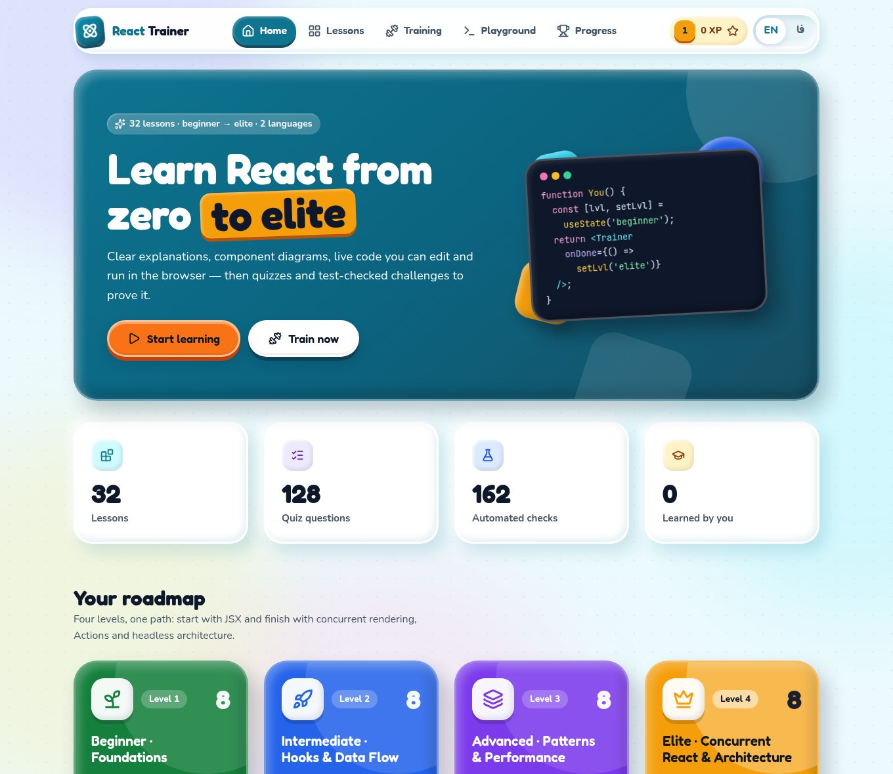
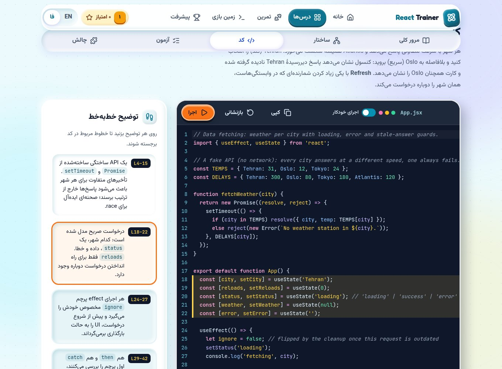
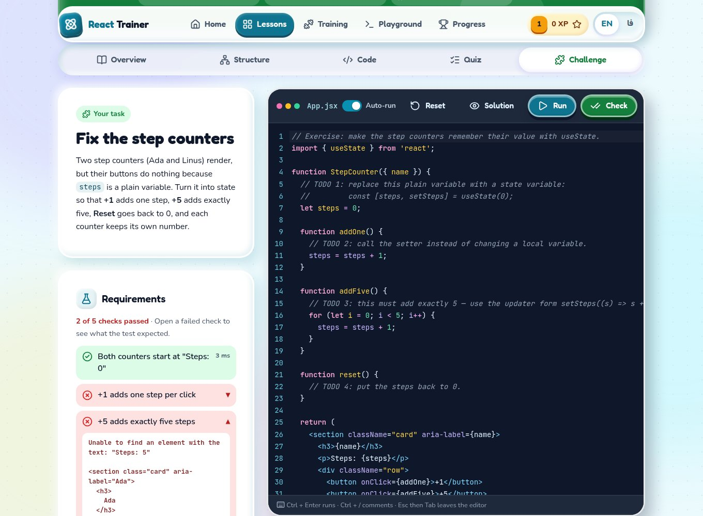

# React Trainer

**▶ Live: [omidrazzaghi2000.github.io/react-trainer](https://omidrazzaghi2000.github.io/react-trainer/)**

A bilingual (**English / فارسی**) web app that teaches **React 19 from beginner to elite**: explanations, component diagrams, live code you can edit and run in the browser, quizzes, and coding challenges checked by automated tests.

It is the sibling of the [C++ Patterns Trainer](https://github.com/omidrazzaghi2000/cpp-patterns-trainer). It uses the same lesson loop, training arena and progress system, and the same *Educational Platform* design (**Claymorphism** + **Vibrant & Block-based**, built with the UI/UX Pro Max skill), recoloured for React.



| Live code (Persian, RTL) | Challenge with automated checks |
|---|---|
|  |  |

## What's inside

**32 lessons in 4 levels**

| Level | Lessons |
|---|---|
| 1 · Beginner | JSX · Components & Props · useState · Events · Conditional Rendering · Lists & Keys · Updating Objects & Arrays · Controlled Forms |
| 2 · Intermediate | Lifting State Up · useEffect · useRef · useReducer · Context · Custom Hooks · Composition & Children · Fetching Data |
| 3 · Advanced | memo / useMemo / useCallback · Refs as Props & useImperativeHandle · useLayoutEffect · Portals · Error Boundaries · lazy & Suspense · Compound Components · useSyncExternalStore |
| 4 · Elite | Reconciliation & Identity · useTransition · useDeferredValue · The use() API · Actions & useActionState · useOptimistic · State Machines · Headless Hooks & Prop Getters |

**Every lesson has five tabs**

1. **Overview**: the big idea, the problem, the React way, a real-world analogy, when to use it, best practices, common pitfalls, pro tips (internals, performance, React 19, the React Compiler), where it shows up in real libraries, and related lessons.
2. **Structure**: a component and data-flow diagram (renders, props, callbacks, hooks, context, subscriptions, state updates, re-renders), the key APIs, and how to apply them.
3. **Code**: a real React 19 example with a line-by-line walkthrough, in an editable editor with a **live preview** and a **console**. Edit it and the preview updates.
4. **Quiz**: 4 questions (concept, code, trade-offs, comparison) with explanations.
5. **Challenge**: complete a starter component. **Check** runs hidden tests written in a Testing-Library-style API and ticks off each requirement. It also has hints, the reference solution, and a "View tests" toggle.

**Live preview, like a real dev server**
- JSX is compiled in the browser by Babel. The component runs in a sandboxed iframe with the React 19 development build, so you see React's real warnings (missing keys, and so on).
- Runtime and syntax errors appear in a Vite-style overlay with a code frame. A clickable `App.jsx:line:col` link jumps to the line in the editor.
- The console panel shows every `console.log`/`warn`/`error` and groups repeated messages.
- An infinite `while (true)` loop is stopped after 1.5 s instead of freezing the tab.
- **Auto-run** re-renders the preview while you type. **Ctrl + Enter** runs, and **Ctrl + Shift + Enter** runs Check in a challenge.

**Training arena**
- **Quiz mix**: random questions from the levels you choose, with shuffled options.
- **Concept match**: read a real-world scenario and pick the React concept.
- **Flashcards**: see the big idea and recall the lesson.
- **Code challenges**: all 32 challenges in one list.

**Progress**: XP, 8 levels (from *Novice* to *React Legend*), 11 badges, a daily streak and per-level progress. Everything is stored in the browser's `localStorage`, with export, import and reset.

**Playground**: write any React component, or load any lesson's example, and see it live.

Totals: 128 quiz questions, 64 real-world scenarios, 162 automated challenge tests, and 128 React programs. Every example renders without React warnings. Every solution passes all of its tests, and every untouched starter fails at least one. This is verified both in jsdom (`npm run validate`) and in a real Chromium.

## Requirements

- **Node.js 18+**. No compiler or browser plugin is needed: code runs in your browser.

## Quick start

```bash
npm install
npm start            # → http://127.0.0.1:3001
```

- **Language:** the app picks English or Persian from the browser language. Switch with the **EN / فا** toggle in the header, or open `http://127.0.0.1:3001/?lang=fa`.
- **Offline:** React, Babel, CodeMirror, the fonts (Fredoka, Nunito, Vazirmatn, JetBrains Mono) and the icons are all served from `node_modules`. After `npm install`, no internet connection is needed.
- It runs next to the C++ trainer, which uses port 3000.

| Script | What it does |
|---|---|
| `npm start` | Start the server (`PORT`, `HOST` env vars are honoured) |
| `npm run dev` | Same, restarting on changes in `server/` or `content/` |
| `npm test` | API, content and sandbox tests (`node:test`), including real jsdom test runs |
| `npm run validate` | Validate all lessons: schema and bilingual completeness. It also renders every example and runs every challenge's tests against the solution (all must pass) and the starter (some must fail) |
| `npm run build:static` | Build a fully static copy into `dist/` (pre-rendered JSON, bundled React). Set `SITE_ORIGIN` to the host's origin |
| `npm run preview:static` | Serve `dist/` at `http://127.0.0.1:4001/react-trainer/`, like GitHub Pages |

## How code runs (and why it's safe)

```
editor ──► Babel (in the page) ──► postMessage ──► sandbox.html iframe
                                                   sandbox="allow-scripts allow-forms allow-modals"
                                                   React 19 dev build · test kit · runtime
          ◄── console / errors / test results ◄──
```

- The iframe has an **opaque origin** (no `allow-same-origin`), so learner code cannot read the app, its cookies or its storage.
- Its CSP allows **no network requests** (`connect-src 'none'`) and **no form navigation**. `localStorage` inside the preview is an in-memory copy that survives "Reload preview".
- The iframe is recreated for every run, so each run starts clean.
- The server never executes learner code. You can expose it (`HOST=0.0.0.0`) without the risks of the C++ trainer's compiler endpoint.
- **Check** runs the tests in a second, hidden sandbox. The same test kit (`public/js/sandbox/testkit.js`) runs in Node with jsdom for `npm run validate`, so a challenge is judged the same way in both places.

## Static hosting (GitHub Pages)

Because code already runs in the browser, the static build has every feature of the server version. On each push to `main`, [.github/workflows/pages.yml](.github/workflows/pages.yml) runs the tests and the content validator, then builds `dist/` and deploys it to GitHub Pages. Static hosts cannot send headers, so both CSPs (the app's and the sandbox's) are delivered as `<meta>` tags.

## Project structure

```
server/
  index.js          entry point (127.0.0.1:3001)
  app.js            Express app, JSON API, CSP for app and sandbox
  content.js        loads and validates content/lessons/*
  bundle.js         bundles React 19 for the browser with esbuild (in memory)
  checks.js         reads the bilingual test names for the challenge checklist
  verify.js         runs programs/tests in jsdom child processes (validator, tests)
  verify-worker.js
  icons.js          builds one SVG sprite from lucide-static
content/
  categories.json   the four levels
  lessons/<id>/     lesson.json · example.jsx · exercise.jsx · solution.jsx · tests.jsx
public/
  index.html, sandbox.html
  css/app.css       design tokens at the top · css/sandbox.css preview defaults
  js/app.js         shell + hash router
  js/i18n.js        every UI string in English and Persian
  js/store.js       progress, XP, levels, badges (localStorage)
  js/views/         home, catalog, lesson, training, progress, playground
  js/components/    diagram, editor (CodeMirror JSX), preview (live preview + console),
                    sandbox (iframe runner), quiz
  js/sandbox/       transpile.js (Babel config + loop guard), testkit.js, runtime.js
scripts/validate-content.js · build-static.js · preview-static.js
.github/workflows/pages.yml   test, validate, build and deploy to GitHub Pages
test/api.test.js
design-system/react-trainer/MASTER.md   generated design system + decisions
CONTENT_SPEC.md   how to write or extend a lesson (schema, test-kit API, diagram rules)
```

## API

| Method & path | Returns |
|---|---|
| `GET /api/meta` | levels, counts, React version |
| `GET /api/lessons` | lesson summaries |
| `GET /api/lessons/:id` | full lesson, including example code, starter, tests and checklist (not the solution) |
| `GET /api/lessons/:id/solution` | reference solution |
| `GET /api/training/quiz?count=&categories=` | shuffled mixed quiz |
| `GET /api/training/match?count=&categories=` | scenario → concept rounds |

## Adding or editing a lesson

Follow [CONTENT_SPEC.md](CONTENT_SPEC.md), using `content/lessons/use-state/` as the reference. Then run:

```bash
npm run validate -- <lesson-id>
```

---

## فارسی

**مربی React** یک برنامهٔ وب دوزبانه (فارسی / انگلیسی) است که React 19 را از سطح مقدماتی تا نخبه آموزش می‌دهد. درس‌ها در ۴ سطح و ۳۲ درس چیده شده‌اند: از JSX و props تا Suspense، Actionها، `useOptimistic` و معماری headless. هر درس شامل این بخش‌هاست:

- توضیح کامل همراه با اشتباه‌های رایج و نکته‌های حرفه‌ای
- نمودار کامپوننت‌ها و جریان داده
- مثال واقعی React 19 که در مرورگر ویرایش می‌کنید و پیش‌نمایش زنده‌اش را می‌بینید
- آزمون چهارسؤالی
- چالش کدنویسی که تست‌های خودکار درستی آن را بررسی می‌کنند

بخش «میدان تمرین» (آزمون ترکیبی، تطبیق مفهوم و فلش‌کارت)، سیستم امتیاز و سطح و نشان‌ها، و «زمین بازی» برای نوشتن هر کامپوننت دلخواه هم در برنامه هست.

راه‌اندازی:

```bash
npm install
npm start      # http://127.0.0.1:3001/?lang=fa
```

کد شما داخل یک iframe ایزوله در همین مرورگر اجرا می‌شود. هیچ کدی روی سرور اجرا نمی‌شود و پیش‌نمایش به شبکه دسترسی ندارد.
